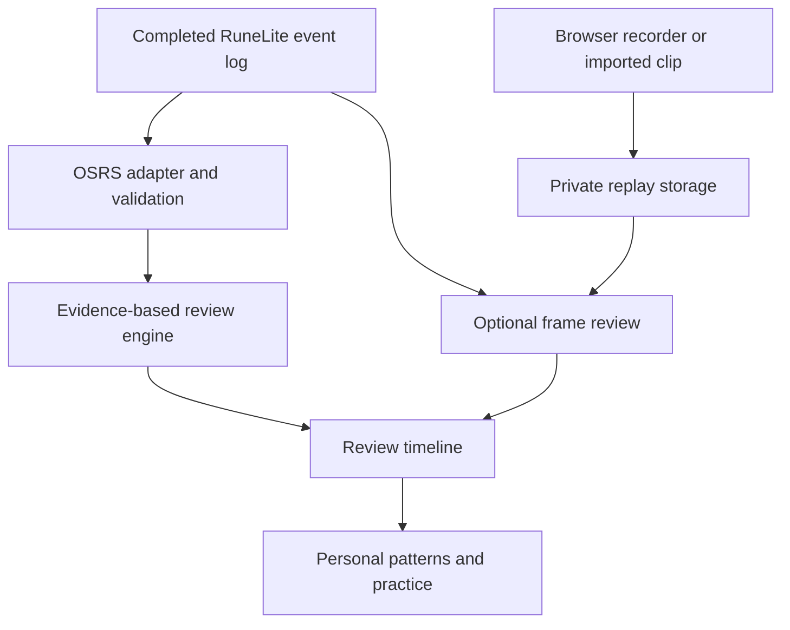

# Architecture

The product separates capture, game-specific observations, review, persistence and the player-facing workspace.

## Code map

- `app/page.tsx`, `app/globals.css`: responsive app, real actions, recording and review flows.
- `lib/capture.ts`: complete-container segmented capture and image-frame extraction.
- `lib/coach/engine.ts`: versioned event validation, OSRS adapter entry point, review rules.
- `lib/coach/demo.ts`: isolated synthetic example; never inserted into history.
- `lib/server.ts`: authenticated ownership, bounded request parsing, DB/blob access.
- `app/api/workspace`: recent 100 session summaries and preferences. Event blobs load only when a review opens.
- `app/api/sessions`: create/read/update/delete; clip routes support range reads and bounded streaming uploads.
- `app/api/sessions/[id]/analyze`: explicit-consent, private AI request with per-user daily quota and validated output.
- `db/schema.ts`, `drizzle`: generated database schema and migration.
- `integrations`: developer-only RuneLite and OBS components, kept out of the browser bundle.

## Persistence and authorization

Every record and clip route checks the authenticated user supplied by the private hosting boundary. Every record lookup includes its owner. Mutation routes reject a different Origin. Clip bytes live in R2; metadata/events live in D1. Browser-created UUIDs make upload retries refer to the same session; a repeated create returns the existing record for its owner. Secrets are only read on the server. Imports have bounded event counts and body size. Clip uploads use fixed-length streams and verified declared limits.

Reviews are saved with their original analysis version. Changing preferences does not silently rewrite old reports. Demonstration data has `source: synthetic` and is rejected by writes. AI observations are stored separately from the deterministic review so model output cannot masquerade as telemetry.

## Adding a game

Define a versioned event schema and a `GameAdapter` with `parse` and `analyze` behavior, then extend the registry and supported API game discriminators. Reuse clips, session storage, ownership, notes and practice infrastructure. Add game-specific acceptance fixtures from real, permissioned matches. Only mark the new game available after those rules and capture sources work. Do not claim Minecraft or COD support because their names appear in the picker.

## Next engineering milestones

1. Real-device media acceptance across Safari/Chrome and background-tab behavior; resilient uploads/resumption and frame alignment.
2. Build and review the RuneLite observer with the Plugin Hub process; benchmark latency and ensure it captures only permitted data.
3. Validate a labeled OSRS corpus with an expert; track false-positive rate separately from missing evidence.
4. Move long AI jobs into a queue, add upload lifecycle cleanup and account storage quotas, then cost monitoring.
5. Extract the adapter interface and generic session types into a shared package once the second game is implemented.

Current limits: at most 100 sessions in the UI, 150 detailed review findings per session, 10,000 imported events, 500,000 JSON characters per AI event timeline, 80 MB per video segment, and six segments per session. The daily AI quota counts attempted provider calls, including failed ones. No team membership, payments, public onboarding or billing system is included.
